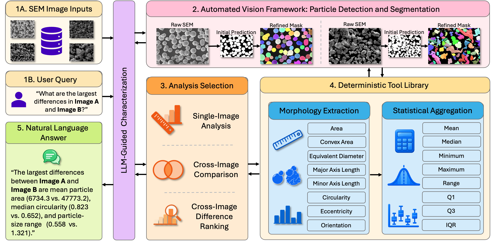

# Evaluating LLMs for Automated SEM Powder Characterization Workflows

Code and data for the [NeurIPS 2026 AI4Mat workshop paper](paper/camera_ready.pdf). This work provides a benchmark for evaluating large language models (LLMs) on numerical characterization, comparison, and tool routing using 20 held-out SEM powder images and their particle measurements.



*SEM images are segmented; an LLM selects analyses and uses deterministic morphology and statistics tools to answer a user's request.*

## Installation

Requires Python 3.10 or newer.

```bash
git clone https://github.com/sprice134/llms_for_cv.git
cd llms_for_cv
python3 -m venv .venv
source .venv/bin/activate
python -m pip install -r requirements.txt
```

`requirements.txt` covers the Python packages. The runner uses standard-library HTTP, so no provider SDK is required. Model servers such as LM Studio or vLLM are installed separately.

## Data and ground truth

The 20 SEM images in `data/images/` are the held-out set from the [DualSight powder dataset](https://github.com/sprice134/DualSight) ([paper](https://doi.org/10.1038/s41598-025-09642-3)). The source COCO export labels them [CC BY 4.0](https://creativecommons.org/licenses/by/4.0/). The measurements in `data/morphology/csvs/` were derived from these images. Cite DualSight for the data and this benchmark for its tasks and evaluations.

For another dataset, add images to `data/images/`, map their IDs in `data/historical/images.json`, set `image_policy.selected_image_ids` and `image_policy.default_limit` in your experiment config, and supply four measurement files per image:

```text
data/morphology/csvs/<image_name>/
  <image_name>_raw.csv         # per-particle measurements
  <image_name>_raw.txt         # text rendering of those measurements
  <image_name>_processed.csv   # summary statistics by Metric
  <image_name>.txt             # text rendering of the summary
```

CSV columns must match `configs/experiments.yaml`. The builder does not segment images: core ground truth comes from `_processed.csv`; interface, case-study, and tool-routing references are calculated from `_raw.csv`.

## Configure a test set

Before inference, choose the images and questions in [configs/experiments.yaml](configs/experiments.yaml). [src/build_task_manifest.py](src/build_task_manifest.py) combines those settings with `data/historical/images.json` and the morphology files to create a fixed `.jsonl` task manifest. Each record contains a prompt, ground truth, and source paths; inference reads these records without generating new questions.

| What to change | Where |
| --- | --- |
| Image IDs and count (`image_policy`); core features, statistics, and prompt templates (`core_benchmark`); interface questions (`interface_suite`) | [configs/experiments.yaml](configs/experiments.yaml) |
| Tool-routing requests and paraphrases | [src/tool_routing.py](src/tool_routing.py) |
| Interface and case-study prompt construction | [src/build_task_manifest.py](src/build_task_manifest.py) |

Edit the YAML to change the included questions or their core wording. A new task or answer type may also need code in the builder and [src/evaluate_numeric.py](src/evaluate_numeric.py). `--suite all` builds core and interface tasks; use `--suite tool_routing` or `--suite case_study` for those sets. Model settings, including the `system_prompt`, are in [configs/models.yaml](configs/models.yaml) and can be chosen after building the manifest.

## Model configurations

The paper used the OpenAI API for paid inference and locally served models through OpenAI-compatible endpoints, with LM Studio as the default local server. [configs/models.yaml](configs/models.yaml) records each model's CLI `label`, `provider`, exact served `model_id`, and request settings. The default endpoints are `https://api.openai.com/v1` (`provider: openai`) and `http://localhost:1234/v1` (`provider: lmstudio`). Load local model weights before running; the config does not load them.

To use another model, copy an entry under `models:` and set its label, model ID, and supported `max_tokens`, `temperature`, and `reasoning_effort`. For example:

```yaml
- label: my-openai-model
  provider: openai
  model_id: exact-provider-model-id
  max_tokens: 1024
  temperature: null
```

The runner reads the OpenAI API key from the current terminal's environment:

```bash
export OPENAI_API_KEY="your-api-key"
```

Start the [LM Studio server](https://lmstudio.ai/docs/developer/core/server) for local runs. For [vLLM](https://docs.vllm.ai/en/stable/serving/openai_compatible_server/) or another OpenAI-compatible `/chat/completions` server, set `--base-url` to its `/v1` endpoint and pass `--api-key` if required. Use a minimal model entry without paper-specific vLLM fields for other servers. A copied config can be selected with `--models-config`; `--list-models` shows configured entries, not provider availability. [Claude](https://platform.claude.com/docs/en/cli-sdks-libraries/libraries/openai-sdk) and [Gemini](https://ai.google.dev/gemini-api/docs/openai) offer compatible endpoints that may work with a custom `provider: openai` entry and matching settings; neither was tested in this benchmark. Native APIs require code changes.

## Run a new experiment

1. **Prepare a task manifest.** To use the published questions, expand the archived manifests to `.jsonl` files (this also expands the score CSVs):

   ```bash
   python scripts/materialize.py
   ```

   To change the questions, copy and edit the experiment config described above, then build a manifest from the configured measurements:

   ```bash
   cp configs/experiments.yaml configs/my_experiment.yaml
   # Edit configs/my_experiment.yaml, then run:
   python src/build_task_manifest.py --suite all --config configs/my_experiment.yaml --output results/manifests/my_tasks.jsonl
   ```

   Set `MANIFEST` below to `results/manifests/my_tasks.jsonl` for this question set. Manifest building calculates references but makes no model requests.

2. **Preflight.** Confirm the model ID is available (LM Studio: `curl http://localhost:1234/v1/models`), then preview the tasks:

   ```bash
   python src/run_inference.py --list-models
   MODEL_LABEL=gpt-5.4-mini-none
   MANIFEST=results/manifests/tasks_image20.jsonl
   # For a custom set: MANIFEST=results/manifests/my_tasks.jsonl
   RUN_ID=example_gpt54mini
   python src/run_inference.py --model-label "$MODEL_LABEL" --manifest "$MANIFEST" --run-id "$RUN_ID" --dry-run
   ```

   `--dry-run` checks the manifest, not credentials or the endpoint. Add `--models-config`, `--base-url`, and `--api-key` as needed to each runner command.

3. **Model inference.** Run the configured model on the selected manifest:

   ```bash
   python src/run_inference.py --model-label "$MODEL_LABEL" --manifest "$MANIFEST" --run-id "$RUN_ID"
   ```

   Responses are saved under `results/raw/<model_label>/<run_id>/`. To try one task first, add `--limit 1`, then rerun the full command with the same run ID:

   ```bash
   python src/run_inference.py --model-label "$MODEL_LABEL" --manifest "$MANIFEST" --run-id "$RUN_ID" --limit 1
   ```

   Check for `success` before a full run. The runner skips existing success and error records; use `--retry-errors` after fixing a failure, or a new run ID after changing model settings.

4. **Score responses.** Use the same model label, manifest, and run ID:

   ```bash
   python src/evaluate_numeric.py --model-label "$MODEL_LABEL" --manifest "$MANIFEST" --run-id "$RUN_ID" --output-prefix "$RUN_ID"
   ```

   Scores and a summary go to `results/evaluation/`. Released manifests cover the 20-image base and 15-image tool-routing, case-study, and reliability sets.

## Released outputs

The compressed `results/manifests/*.jsonl.gz` contains prompts and ground truth; `results/evaluation/*_scores.csv.gz` contains responses and scores. To rebuild the main table and figure:

```bash
python scripts/materialize.py
python src/build_paper_artifacts.py --no-refresh --artifact-set main --format pdf
```

The generated artifacts are in `paper/generated/`. The upstream segmentation pipeline and weights are outside this benchmark release.

## Citation

Please cite both papers when using the released image data and benchmark:

```bibtex
@inproceedings{price2026evaluating,
  title     = {Evaluating {LLMs} for Automated {SEM} Powder Characterization Workflows},
  author    = {Price, Stephen and Judd, Kiran G. and Cote, Danielle L. and Rundensteiner, Elke A.},
  booktitle = {AI4Mat: AI for Accelerated Materials Design Workshop at NeurIPS},
  year      = {2026}
}

@article{price2025dualsight,
  title   = {{DualSight}: Multi-Stage Instance Segmentation Framework for Improved Precision},
  author  = {Price, Stephen and Judd, Kiran and Tsaknopoulos, Kyle and Neamtu, Rodica and Cote, Danielle L.},
  journal = {Scientific Reports},
  volume  = {15},
  pages   = {27521},
  year    = {2025},
  doi     = {10.1038/s41598-025-09642-3}
}
```
